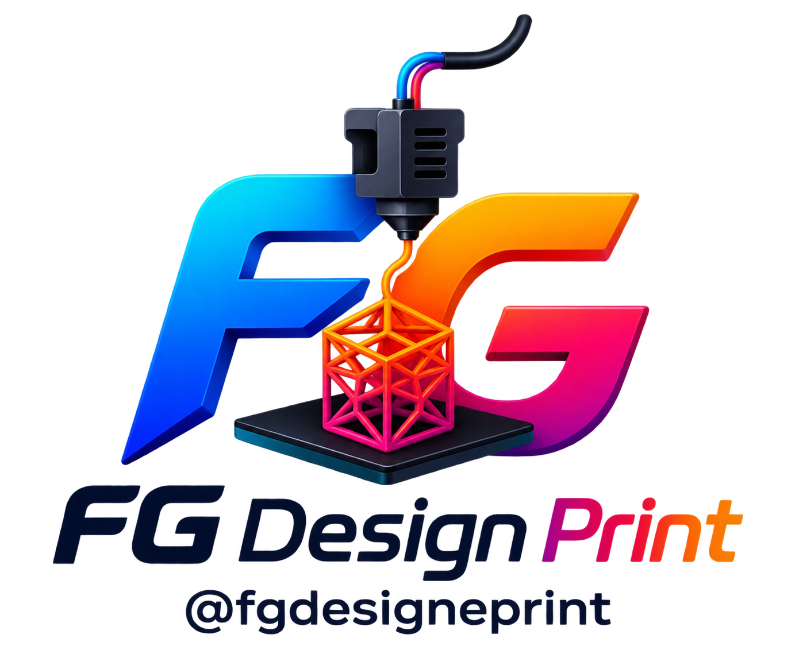

# FG Precificador 3D

Programa para Windows que transforma os dados do Bambu Studio em custos e preços de venda de impressão 3D. Desenvolvido pela **FG Design Print**.



**[Baixar o instalador e a versão portátil](https://github.com/mouratech-udi/fg-precificador-3d/releases/latest)** · **[Guia de uso](docs/GUIA.md)** · [Instagram da FG](https://www.instagram.com/fgdesigneprint/)

## O que o programa oferece

- Importação local de projetos `.3mf` configurados no Bambu Studio e leitura de fatiamentos salvos, incluindo arquivos `.gcode` compatíveis.
- Fatiamento automático pelo Bambu Studio instalado, com conferência dos parâmetros originais, sem modificar o arquivo de origem ou enviar o trabalho para a impressora.
- Cálculo de material, energia, reserva da máquina, tempo adicional, mão de obra, lucro e taxa opcional da Shopee.
- Histórico local com miniaturas, edição, exclusão e recuperação da última exclusão.
- PDF para cliente com **sua própria logo, empresa e contatos**, além de PDF detalhado interno, HTML e CSV.
- Instalação por usuário, atalho na área de trabalho e versão portátil com runtime incluído.

## Instalação

Requer Windows 10/11 de 64 bits. Baixe o `.msi` na página de versões e execute-o, ou extraia o ZIP portátil inteiro e abra `FG.Precificador.exe`.

O Bambu Studio precisa estar instalado para analisar projetos que ainda não contenham resultados de fatiamento. Para `.3mf` já fatiado ou `.gcode` com peso e tempo reconhecíveis, o programa lê os dados salvos.

## Personalizar o PDF da sua empresa

1. Abra **Empresa / PDF do cliente**.
2. Informe o nome da sua empresa e os contatos que deseja imprimir.
3. Escolha sua logo PNG ou JPG, ou use somente o nome.
4. Clique em **Salvar dados da empresa**.
5. Em um orçamento, escolha **Exportar orçamento → PDF para cliente**.

Também podem ser configurados CPF/CNPJ opcional, telefone/WhatsApp, e-mail, Instagram, site, endereço, cidade/estado, responsável, validade e condições de pagamento e entrega. Campos em branco não são impressos.

A identidade da FG permanece no programa e nos relatórios internos. O PDF para cliente utiliza a empresa cadastrada. Novas instalações começam com o histórico vazio. Cadastros, logos e orçamentos ficam no computador de cada usuário e não são enviados ao GitHub.

## Como o preço é calculado

```text
Custo de impressão = material + energia + máquina + tempo adicional + outros custos
Preço direto = custo de impressão × (1 + lucro %) + mão de obra
Preço com Shopee = (preço direto + taxa fixa) ÷ (1 − percentual)
```

Os padrões iniciais são R$ 100/kg de filamento, 100% de lucro sobre os custos de impressão e R$ 20 de mão de obra adicionados ao final. Energia e desgaste da máquina começam com estimativas ajustáveis. Revise os parâmetros para seu equipamento e sua região. A taxa da Shopee começa desativada e deve ser ajustada às condições aplicáveis à venda.

**Unidades já contidas no arquivo** divide o consumo entre unidades que realmente estão naquele projeto. **Quantidade do pedido** multiplica o preço, sem simular um novo lote. Para estimar a economia de um lote, importe o lote configurado no fatiador.

## Compilar e verificar

Requer SDK .NET 10 no Windows.

```powershell
dotnet restore src/FG.Precificador/FG.Precificador.csproj --locked-mode
dotnet build src/FG.Precificador/FG.Precificador.csproj -c Release --no-restore
New-Item -ItemType Directory -Path artifacts -Force
dotnet src/FG.Precificador/bin/Release/net10.0-windows/win-x64/FG.Precificador.dll --self-test artifacts/autoteste.json
```

O autoteste usa apenas exemplos fictícios. Exercita preços, taxas, múltiplas mesas, preservação de originais, diferenças entre versões do Bambu Studio, PDFs, empresa personalizada, histórico e recuperação de exclusões. O fluxo de verificação também roda no GitHub Actions.

Para gerar a distribuição:

```powershell
./scripts/Publicar.ps1
```

O script gera a pasta portátil e seu ZIP em `artifacts`. Para gerar também o instalador MSI, informe o caminho de uma instalação do WiX 4:

```powershell
./scripts/Publicar.ps1 -Wix 'C:\ferramentas\wix\wix.exe'
```

## Dados e limites

- O histórico fica em `%LOCALAPPDATA%\FG Design Print\Precificador`. Use **Backup dos dados** antes de mover a instalação.
- A logo cadastrada é incorporada ao backup JSON. As miniaturas dos projetos são armazenadas separadamente.
- Nunca publique backups, arquivos de clientes, modelos 3D, certificados ou credenciais neste repositório.
- Tempo e material são estimativas digitais. Purga inicial, calibração, perdas e embalagem podem exigir custos adicionais.
- Projetos com produtos diferentes não devem ter seu consumo dividido igualmente; importe-os separadamente ou trate o conjunto como uma unidade de venda.

## Autoria e componentes

Desenvolvido pela FG Design Print · [@fgdesigneprint](https://www.instagram.com/fgdesigneprint/).

A identidade visual identifica a autoria do aplicativo. A logo do PDF para cliente é configurável. As licenças dos componentes de terceiros, incluindo .NET e PDFsharp-GDI **6.2.4** (MIT), estão em [THIRD-PARTY-NOTICES](THIRD-PARTY-NOTICES).
